# Tecbricks IMS — Complete Enterprise Inventory Management & POS System

> **An all-in-one commercial platform engineered for retail stores, wholesale distributors, warehouses, and multi-branch enterprises.**  
> Effortlessly manage multi-warehouse stock, high-velocity point-of-sale checkouts, procurement pipelines, commercial invoicing, and double-entry financial accounting.

---

## Table of Contents
1. [Executive Overview](#executive-overview)
2. [Complete Visual Tour & Screen Showcase](#complete-visual-tour--screen-showcase)
   - [1. Device Activation & Tenant Onboarding](#1-device-activation--tenant-onboarding)
   - [2. Executive Analytics Dashboard](#2-executive-analytics-dashboard)
   - [3. Point of Sale (POS) Checkout Terminal](#3-point-of-sale-pos-checkout-terminal)
   - [4. Multi-Warehouse & Inventory Logistics](#4-multi-warehouse--inventory-logistics)
   - [5. Commercial Order Fulfillment & Invoicing](#5-commercial-order-fulfillment--invoicing)
   - [6. Product Catalog & Master Data Management](#6-product-catalog--master-data-management)
   - [7. Partner CRM (Customers & Suppliers)](#7-partner-crm-customers--suppliers)
   - [8. Financial Accounting & Expense Tracking](#8-financial-accounting--expense-tracking)
   - [9. Business Intelligence & Financial Reports](#9-business-intelligence--financial-reports)
   - [10. Organization Settings & Configuration](#10-organization-settings--configuration)
3. [Comprehensive Features Matrix](#comprehensive-features-matrix)
4. [Hardware Compatibility](#hardware-compatibility)

---

## Executive Overview

**Tecbricks IMS** provides businesses with a centralized operational system that synchronizes sales, stock levels, purchasing, and finances. Built to eliminate inventory discrepancies, streamline daily cashier operations, and provide executives with real-time financial transparency, the system supports both single-register retail stores and complex multi-warehouse supply chains.

---

## Complete Visual Tour & Screen Showcase

### 1. Device Activation & Tenant Onboarding

The secure onboarding gate registers authorized tenant organizations and binds workstations for verified corporate access.

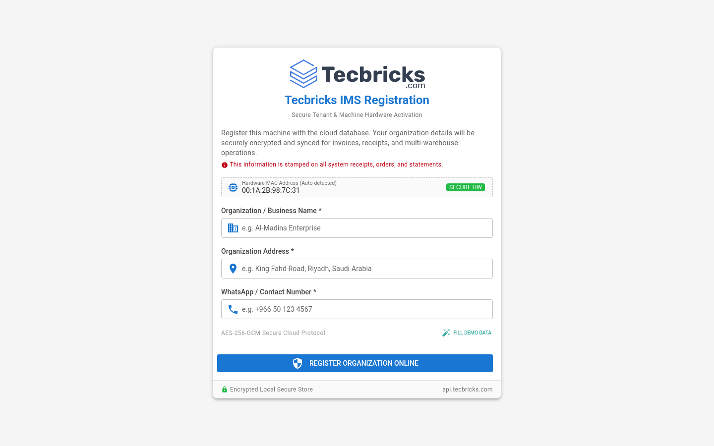

**Key Capabilities:**
- **Automated Machine Identity Verification**: Recognizes authorized enterprise devices for fast activation.
- **Tenant Profile Provisioning**: Configures organization legal name, business address, contact telephone, and currency preference.
- **Corporate Subscription Management**: Dynamic tier capabilities spanning Trial, Basic, Premium, and Enterprise plans.
- **Instant Activation**: Quick one-click onboarding to launch straight into active operations.

---

### 2. Executive Analytics Dashboard

The central command dashboard provides a real-time pulse of business health, daily liquidity, monthly expenditures, and recent transactions.

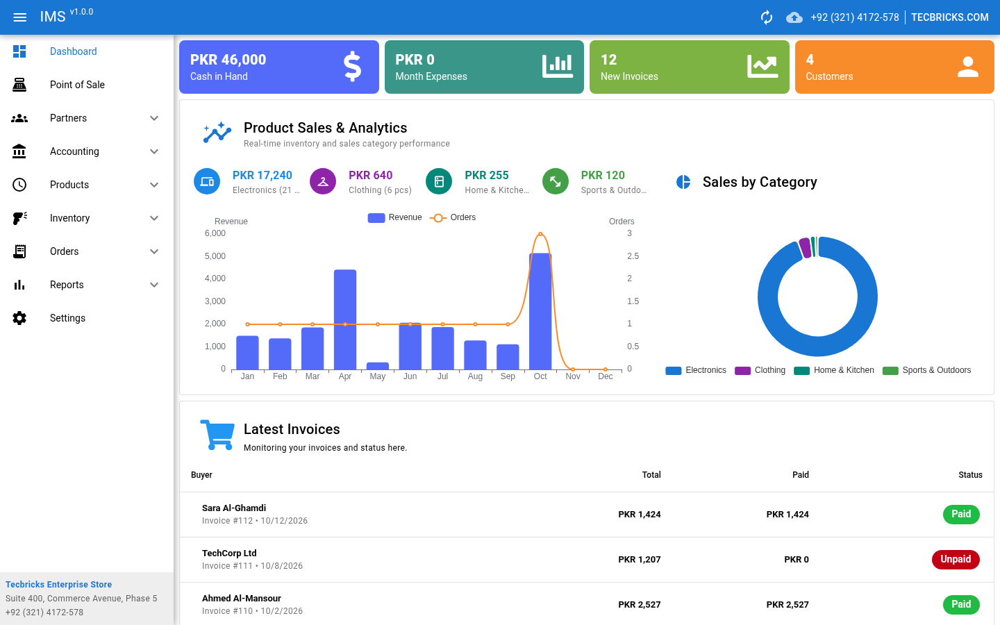

**Key Capabilities:**
- **Rounded Liquidity & Performance Tiles**: High-contrast top tiles displaying *Cash in Hand*, *Month Expenses*, *New Invoices*, and *Active Customers*.
- **Product Sales & Analytics Graph**: Dynamic sales velocity charting comparing revenue patterns over custom periods.
- **Category Sales Breakdown**: Visual distribution of product performance and sales volume across departments.
- **Live Invoices Feed**: Real-time record of incoming transactions with customer names, invoice numbers, settlement amounts, and payment status tags.

---

### 3. Point of Sale (POS) Checkout Terminal

Optimized for fast-paced cash registers, supermarkets, and specialty retail counters where speed and accuracy are critical.

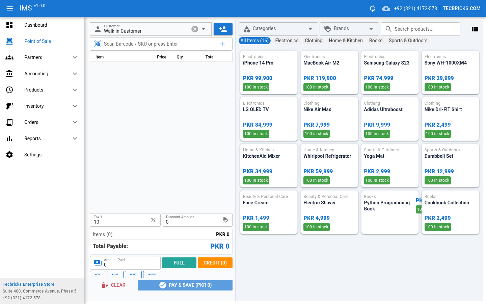

**Key Capabilities:**
- **High-Velocity Barcode & SKU Search**: Instant item lookup with hardware barcode scanner integration and smart keyword filtering.
- **Visual Product Catalog**: Responsive product grid showing item images, stock availability badges, and unit pricing.
- **Interactive Cart Controls**: Easy quantity stepping, line-item adjustments, and order clearing.
- **Flexible Customer Assignment**: Quick selection of Walk-in Customers or dedicated account holders with credit tracking.
- **Multi-Tender Payment Processing**: Supports Cash, Bank Transfer, and Card payments with instant receipt generation.

---

### 4. Multi-Warehouse & Inventory Logistics

Maintain total inventory integrity across central distribution hubs, retail branches, and transit holding areas.

#### Warehouse Management
Track real-time stock levels, storage capacities, and warehouse assignments across all business locations.

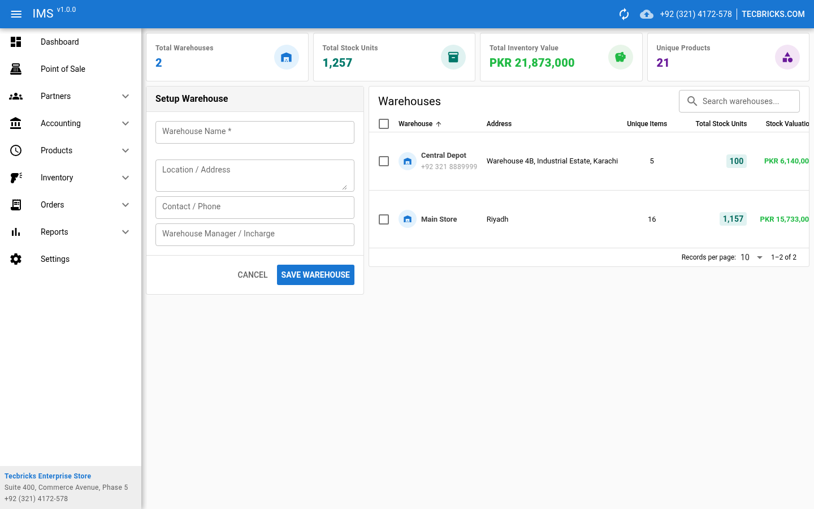

#### Stock Adjustments & Reconciliation
Audit and balance physical inventory against system records with audit-ready justification logging.

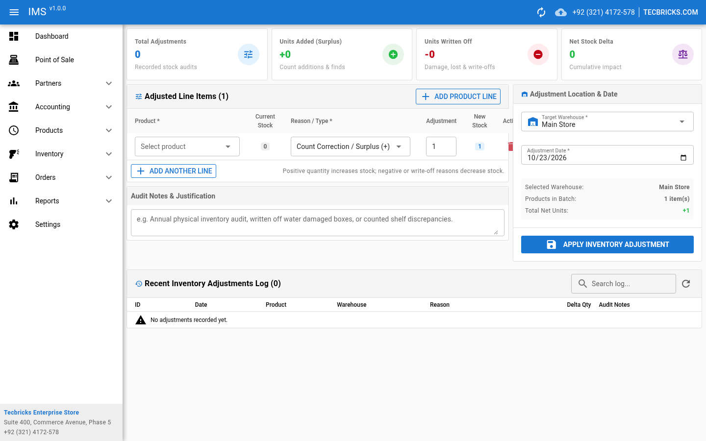

#### Internal Warehouse Transfers
Seamlessly transfer merchandise between branch warehouses with dispatch verification and arrival tracking.

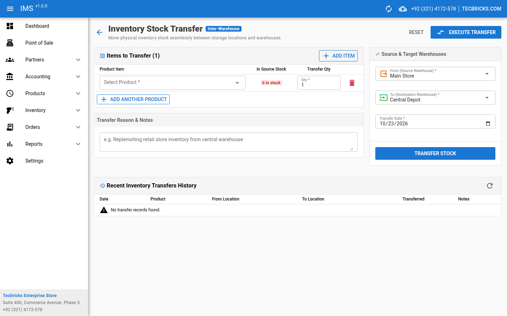

**Key Capabilities:**
- **Multi-Location Inventory Balances**: View on-hand inventory individually per warehouse or aggregated company-wide.
- **Audit-Logged Adjustments**: Record inventory counts, damages, expired items, and reconciliation write-offs.
- **Inter-Branch Stock Movement**: Transfer goods between facilities with tracking and verification.
- **Automated Reorder Warnings**: Proactively identify low stock levels before replenishment shortages occur.

---

### 5. Commercial Order Fulfillment & Invoicing

A unified pipeline for processing customer sales orders and managing supplier procurement lifecycles.

#### Orders & Billing Directory
Centralized order repository showing invoice IDs, customer identities, payment status, dates, and order values.

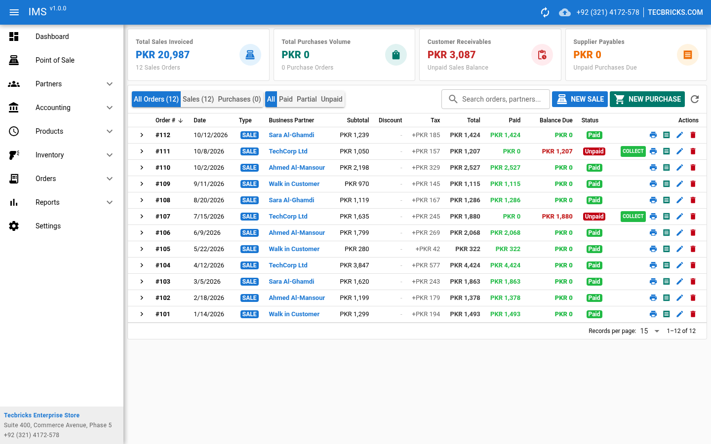

#### Sales Order Creation & Invoicing (Sale Order v2)
Comprehensive order entry form with automatic inventory lookup, tax computations, and customer invoicing.

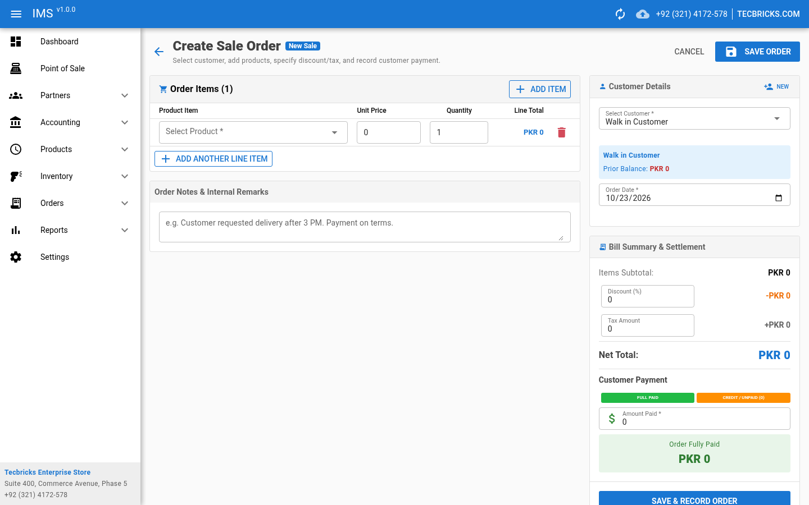

#### Purchase Order Procurement (Purchase Order v2)
Supplier purchase order generator with vendor selection, expected delivery scheduling, and unit cost tracking.

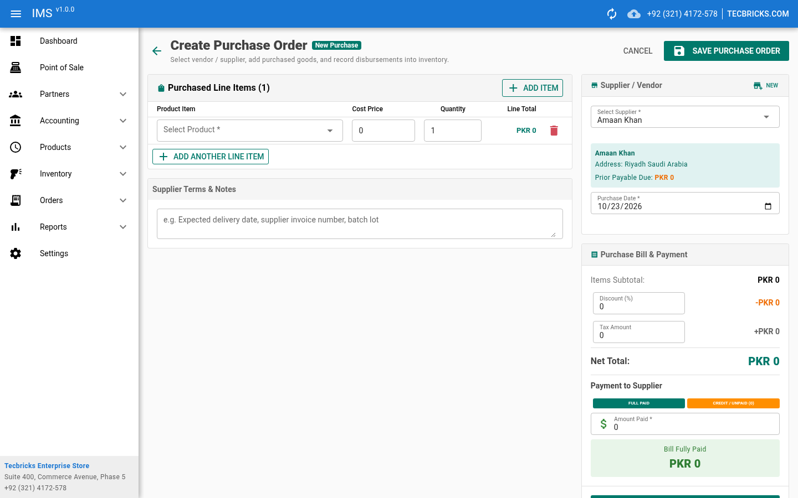

**Key Capabilities:**
- **Dual Sales & Purchase Workflows**: Complete control over outbound revenue generation and inbound procurement costs.
- **Line-Item Tax & Discount Engines**: Automated calculation of subtotal, percentage discounts, and regional sales taxes.
- **Multi-Format Receipt Engine**: Instant generation of 80mm/58mm thermal receipts and standard A4/Letter tax invoices.
- **Order Lifecycle Statuses**: Clear status indicators across Paid, Pending, and Partial payment states.

---

### 6. Product Catalog & Master Data Management

Structure, categorize, and price merchandise with rich product attributes, barcode identifiers, and unit definitions.

#### Product Catalog
Comprehensive item directory with SKU identifiers, retail pricing, purchase cost, and real-time inventory counts.

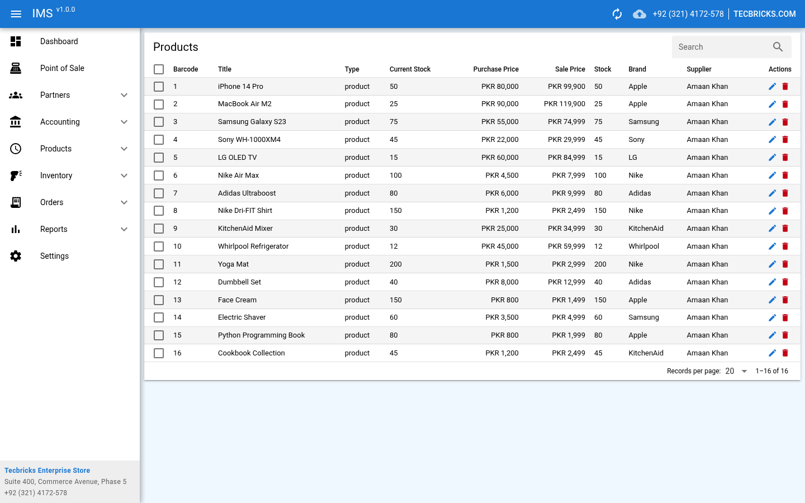

#### Product Categories
Organize merchandise into structured departments and taxonomy groups for focused reporting.

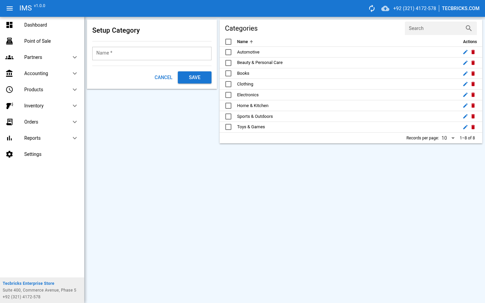

#### Brand & Manufacturer Management
Group products by brand, manufacturer, or vendor lines for specialized analytics.

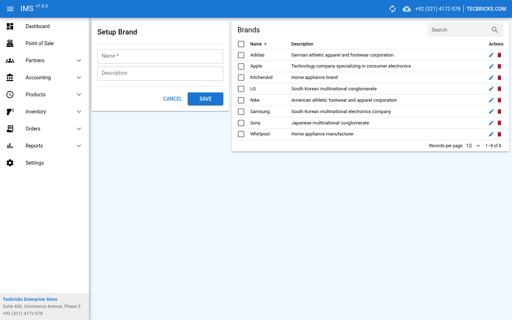

#### Measurement Units
Define standard and custom units of measurement (Pieces, Kilograms, Liters, Boxes, Cartons).

**Key Capabilities:**
- **Comprehensive Master Data**: Manage SKUs, barcodes, product descriptions, unit costs, and retail sale prices.
- **Hierarchical Classification**: Structure products by Category, Brand, and Unit for reporting and POS navigation.
- **Stock Valuation Integration**: Automatically calculates current stock value based on real-time inventory counts and purchase costs.

---

### 7. Partner CRM (Customers & Suppliers)

Maintain strong commercial relationships with complete profiles for all business contacts.

#### Partners Master Directory
Unified contact management view for both clients and vendors with contact details and account balances.

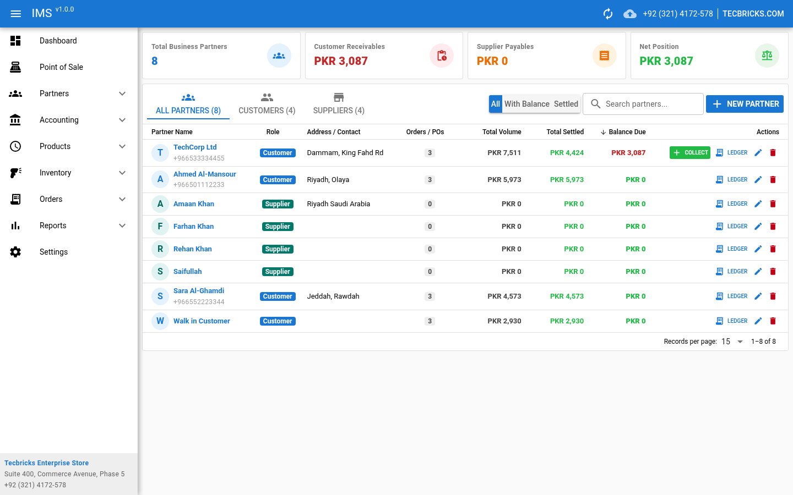

#### Customer Management
Detailed client ledger profiles, delivery addresses, telephone contacts, and credit histories.

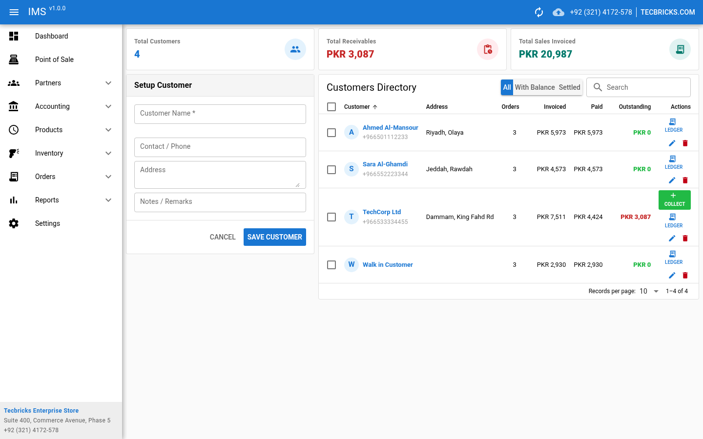

#### Supplier Management
Vendor directory with procurement histories, billing terms, and supplier payment balances.

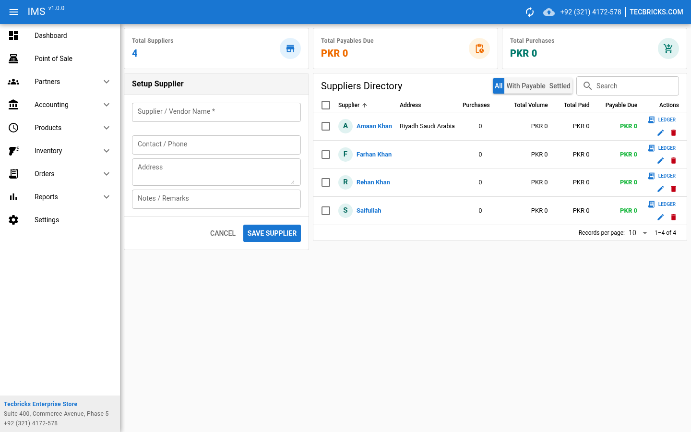

**Key Capabilities:**
- **Unified Contact Records**: Centralized database for customers, corporate clients, distributors, and raw material suppliers.
- **Credit Limit & Outstandings Tracking**: Real-time ledger view of receivables and payables for each partner.
- **Direct Order History**: View all historical purchase orders and sales invoices tied to any specific partner.

---

### 8. Financial Accounting & Expense Tracking

Built-in double-entry accounting keeps cash flow, bank balances, and operational overheads strictly balanced.

#### Chart of Accounts & General Ledger
Manage cash registers, petty cash accounts, and commercial bank accounts with real-time balance tracking.

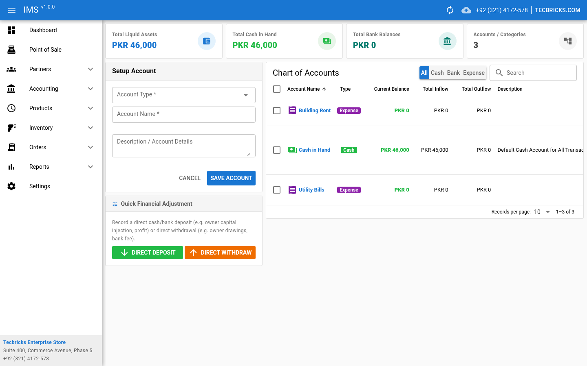

#### Operational Expense Management
Record day-to-day business expenditures (rent, utilities, salaries, marketing) with categorized expense vouchers.

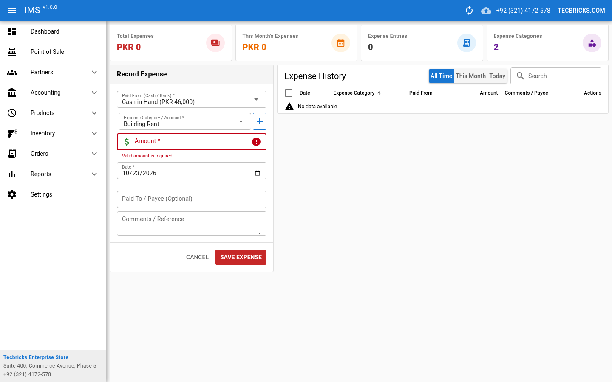

#### Account-to-Account Fund Transfers
Move funds between internal accounts (e.g., Cash Drawer to Bank Deposit) with full audit trails.

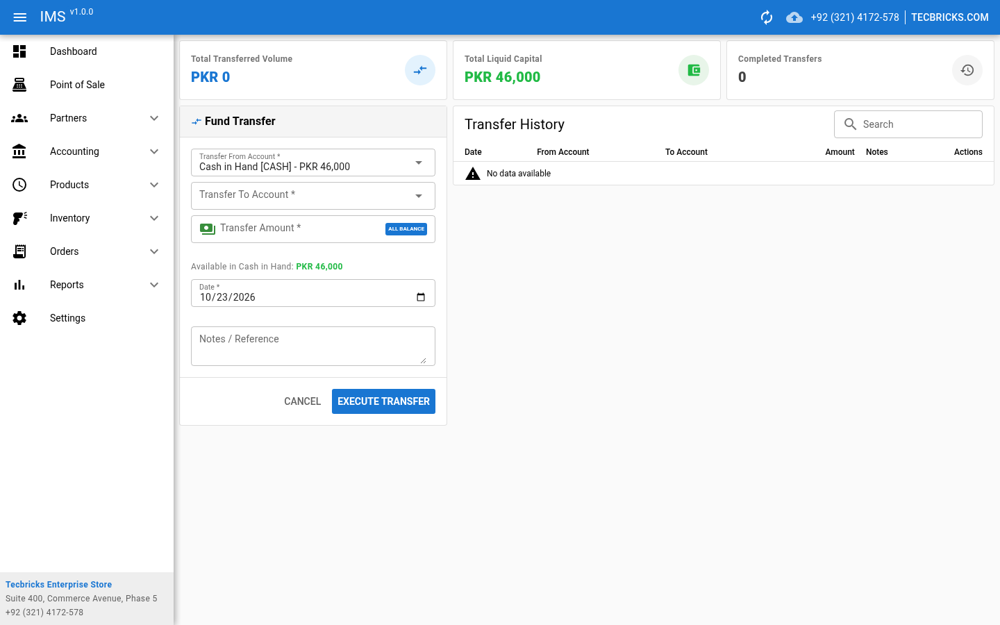

**Key Capabilities:**
- **Multi-Account Structure**: Dedicated tracking for Cash in Hand, Bank Accounts, Petty Cash, and Asset Accounts.
- **Categorized Expense Bookkeeping**: Log overheads against designated expense accounts for accurate profit-and-loss evaluation.
- **Internal Fund Rebalancing**: Record inter-account liquidity transfers with date, voucher reference, and descriptions.

---

### 9. Business Intelligence & Financial Reports

Gain deep operational insights with exportable business intelligence reports.

#### Stock Valuation & Inventory Reports
Detailed inventory reports showing on-hand quantities, cost valuation, retail value, and profit potential per SKU.

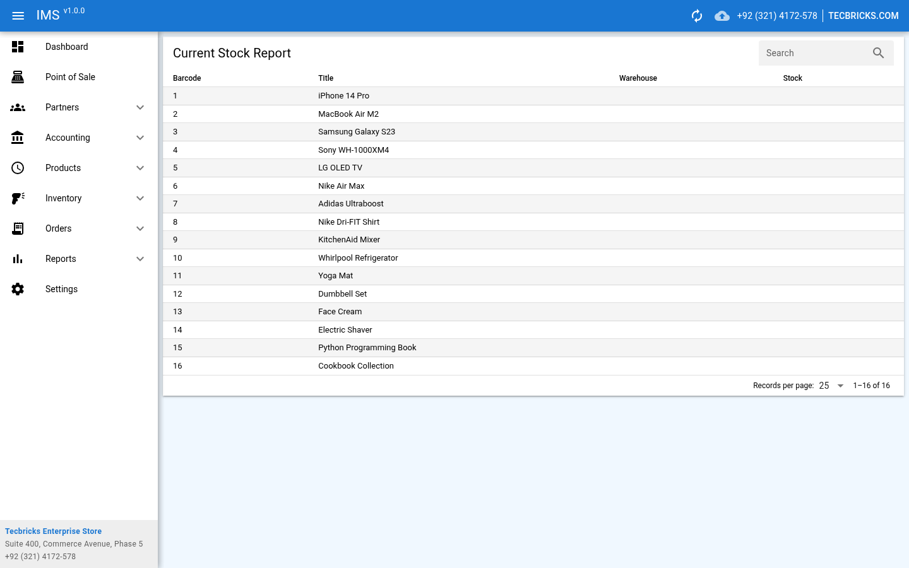

#### Customer Outstandings & Aging Receivables
Comprehensive accounts receivable ledger highlighting overdue customer balances and aging schedules.

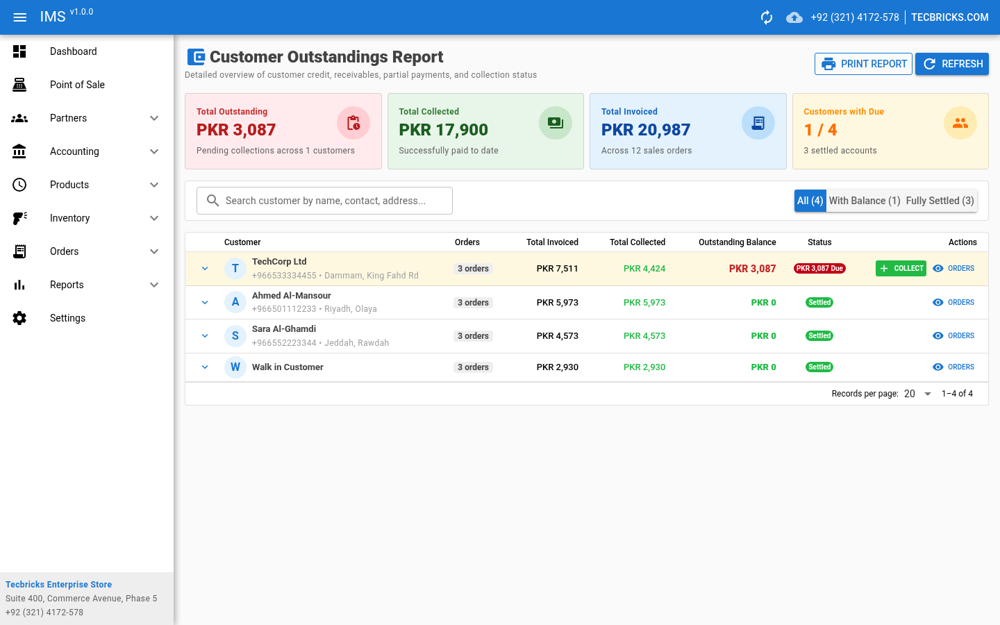

**Key Capabilities:**
- **Comprehensive Stock Valuation**: Automatically compute total inventory net worth across branches.
- **Aging Receivables Management**: Track client debt aging to accelerate collection and maintain healthy cash flow.
- **Statement Generation**: Generate formal customer statements showing all transactions, payments, and running balances.

---

### 10. Organization Settings & Configuration

Configure business profiles, tax rules, and operational defaults for seamless multi-terminal deployment.

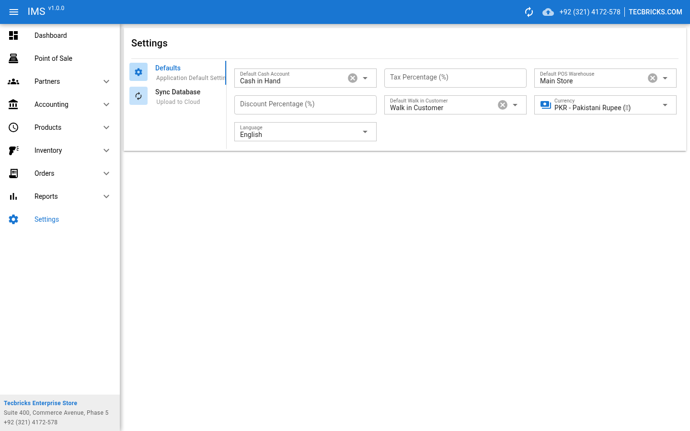

**Key Capabilities:**
- **Default Account Assignment**: Designate default cash drawers, primary bank accounts, and default sales warehouses.
- **Currency & Localization**: Set primary currency symbol, formatting conventions, and regional tax percentages.
- **Walk-in Customer Defaults**: Pre-configure default counter profiles for frictionless, high-speed retail checkout.

---

## Comprehensive Features Matrix

| Module | Core Capability | Business Benefit |
| :--- | :--- | :--- |
| **Point of Sale** | Fast Barcode & SKU Lookup | Accelerates checkout speed and eliminates cashier entry errors |
| **Point of Sale** | Multi-Tender Payment Support | Accepts Cash, Card, and Bank Transfers effortlessly |
| **Inventory** | Multi-Warehouse Tracking | Centralizes stock visibility across all stores and distribution hubs |
| **Inventory** | Inter-Warehouse Stock Transfers | Balances stock levels between branches with full traceability |
| **Inventory** | Audit Adjustments & Shrinkage | Logs physical stock count discrepancies with reason codes |
| **Orders** | Invoicing & Order Pipelines | Streamlines quotation, order confirmation, and payment capture |
| **Orders** | Dual Receipt & A4 Printing | Generates 80mm thermal receipts and standardized A4 business invoices |
| **Master Data** | Categories, Brands & Units | Organizes thousands of SKUs into clear, searchable catalog hierarchies |
| **CRM** | Customer & Vendor Directory | Tracks credit limits, purchase histories, and contact records |
| **Accounting** | Double-Entry Account Ledgers | Maintains balanced ledgers across cash, petty cash, and banks |
| **Accounting** | Expense Voucher Tracking | Categorizes operating overheads for accurate margin calculations |
| **Reports** | Stock Valuation & Balance Sheets | Provides audit-ready net worth and inventory asset valuation |
| **Reports** | Customer Outstandings & Aging | Accelerates debt recovery and prevents cash flow bottlenecks |
| **Onboarding** | Machine Activation & Multi-Tenant | Secures corporate data with validated workstation licensing |

---

## Hardware Compatibility

- **Barcode Scanners**: Compatible with standard USB and wireless 1D/2D handheld barcode readers.
- **Thermal Receipt Printers**: Native support for 80mm and 58mm POS thermal printers (ESC/POS standard).
- **Office Document Printers**: Clean layout generation for Letter and A4 invoices and reports.
- **Cash Drawers**: Standard kick-out integration triggered upon receipt printing.

---

*Tecbricks IMS — Delivering operational excellence, stock accuracy, and profitable growth.*
